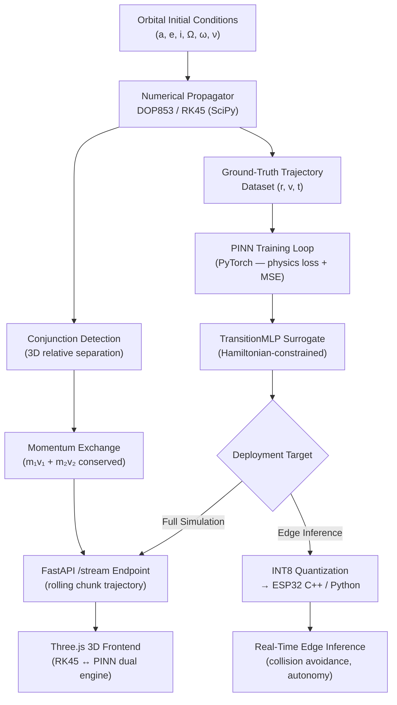

# NanoDynamics

> **Earth-Moon orbital dynamics simulator and autonomous satellite swarm collision-avoidance system powered by Physics-Informed Neural Network (PINN) surrogates, with real-time edge inference on ESP32 hardware.**

[](https://python.org)
[](https://pytorch.org)
[](https://fastapi.tiangolo.com)
[](https://scipy.org)
[](https://espressif.com)
[](LICENSE)

---

## Problem Solved

Classical numerical orbital integrators (RK45, DOP853) are too computationally expensive for nanosatellite microcontrollers operating under severe power and memory budgets. A single trajectory propagation step on ESP32-class hardware takes tens of milliseconds using Runge-Kutta — orders of magnitude too slow for real-time autonomous collision avoidance in swarm scenarios.

**NanoDynamics** solves this by training Physics-Informed Neural Network (PINN) surrogate models that embed Newtonian mechanics and energy conservation directly into the loss function during training. The resulting `TransitionMLP` model is quantized and ported to C++/Python for real-time edge inference on ESP32 microcontrollers, delivering trajectory predictions orders of magnitude faster than numerical integration while respecting physical constraints. The companion full-stack 3D simulator (FastAPI + Three.js) provides a high-fidelity real-scale testbed for validating PINN accuracy against numerical ground truth across Earth-Moon cislunar space.

## Architecture Overview

The system is split into two layers: a **training and simulation backend** (Python, FastAPI, PyTorch) and an **edge inference layer** (quantized C++/Python for ESP32). On the backend, `scipy.integrate.solve_ivp` (DOP853) generates ground-truth trajectories incorporating two-body gravity, J₂ oblateness, exponential/US-76 atmospheric drag, and lunar three-body perturbations. These trajectories train the `TransitionMLP` PINN surrogate, which enforces Hamiltonian energy conservation as a physics residual in the loss. The trained model is quantized to INT8/FP16 and compiled for ESP32 deployment. A rolling `/stream` FastAPI endpoint feeds trajectory chunks to a Three.js 3D frontend for real-time visualization with dual RK45/PINN engine switching.



---

## Core Engineering Features

- **Dual-Engine Propagation (RK45 ↔ PINN):** Switch between classical numerical integration (`solve_ivp` DOP853) and the offline PyTorch PINN surrogate (`TransitionMLP`) in real time. Clone any satellite with a single click to run side-by-side comparison across engines in the 3D viewport.
- **Physics-Informed Neural Network Surrogate:** `TransitionMLP` is trained with a composite loss: MSE trajectory error + Hamiltonian energy conservation residual. Embedding physics into training — not just as a post-hoc check — prevents the model from learning physically impossible trajectories.
- **Real-Scale Earth-Moon Cislunar Dynamics:** Full multi-body mechanics covering 100 km LEO through 400,000 km cislunar space. Models include: central two-body gravity, J₂ oblateness, US Standard Atmosphere 1976 exponential drag, lunar ephemeris, and third-body perturbations. Supports Trans-Lunar Injection (Δv ≈ 3,100 m/s) and Lunar Orbit Insertion maneuvers.
- **Swarm Collision Detection & Momentum Exchange:** Real-time conjunction detection using 3D relative separation and closing velocity. Computes elastic/inelastic 3D momentum exchange (configurable restitution coefficient e ∈ [0,1]), conserves linear momentum across the swarm, triggers visual shockwave FX, and re-propagates post-impact orbits on both engines.
- **ESP32 Edge Deployment:** Trained PINN is quantized (INT8/FP16) and compiled for embedded deployment. Achieves real-time orbital propagation and collision avoidance inference on ESP32 hardware — orders of magnitude faster than equivalent Runge-Kutta at equivalent hardware constraints.

---

## Repository Structure

```
NanoDynamics/
├── leo_simulator/
│   ├── constants.py               # WGS-84 geodetic params, lunar constants, atmo defaults
│   ├── experiment.py              # Parametric sweep engine & deorbit lifetime analysis
│   ├── models/
│   │   ├── gravity.py             # Two-body gravity, J2 oblateness, lunar 3rd-body
│   │   ├── drag.py                # Exponential & US-76 atmospheric density + co-rotating drag
│   │   └── dynamics.py            # EOM: d/dt[r,v] = [v, a_total], force decomposition
│   ├── orbit/
│   │   ├── collision.py           # Conjunction detection & 3D momentum exchange kinematics
│   │   ├── elements.py            # Keplerian orbital elements conversions [a,e,i,Ω,ω,ν]
│   │   ├── pinn_propagator.py     # Offline PINN surrogate with Hamiltonian projection
│   │   └── satellite.py           # Spacecraft specs (mass, cross-section, Cd, ballistic coeff)
│   ├── propagator.py              # High-order numerical propagator (DOP853 via SciPy)
│   ├── main.py                    # Headless verification run & trajectory generator
│   ├── ai/
│   │   ├── pinn_model.py          # PyTorch PINN architecture (TransitionMLP)
│   │   └── train.py               # Physics-informed training loop (Newtonian conservation)
│   └── tests/
│       ├── test_app.py            # E2E API tests (validation, streaming, burns)
│       ├── test_challenger1_stress.py  # Stress tests (concurrency, energy conservation)
│       ├── test_collision.py      # Momentum conservation & deflection API tests
│       ├── test_elements.py       # Keplerian elements round-trip conversion tests
│       └── test_experiment.py     # Parametric sweep & atmospheric density unit tests
├── main.py                        # FastAPI server entrypoint (rolling /stream endpoint)
├── visualization_3d/              # Three.js 3D frontend (dual-engine, real-scale cislunar)
├── requirements.txt
└── pyproject.toml
```

---

## Quickstart

### Prerequisites

```bash
git clone https://github.com/joachimgrobbelaar/NanoDynamics.git
cd NanoDynamics
pip install -r requirements.txt
# Core deps: numpy, scipy, torch, fastapi, uvicorn, pytest, httpx, matplotlib
```

### Run the Simulation Backend

```bash
uvicorn main:app --host 0.0.0.0 --port 8001
# Open visualization at http://localhost:8001
```

### Train the PINN Surrogate

```bash
cd leo_simulator
python ai/train.py
# Trains TransitionMLP with physics-informed loss; saves model checkpoint
```

### Headless Trajectory Verification

```bash
python leo_simulator/main.py
# Runs dual-engine comparison (RK45 vs PINN), outputs trajectory.json
```

### Run the Test Suite

```bash
pytest leo_simulator/tests/ -v
```

### Parametric Deorbit Lifetime Sweep

```bash
python -c "
from leo_simulator.experiment import run_parametric_sweep
run_parametric_sweep(variable='altitude', n_points=100)
"
```

---

## Physics Model Reference

| Force | Model |
|-------|-------|
| Central Gravity | Two-body: −(μ/r³)r, μ⊕ = 3.986×10¹⁴ m³/s² |
| Earth Oblateness | J₂ perturbation (WGS-84, J₂ = 1.08263×10⁻³) |
| Atmospheric Drag | US Standard Atmosphere 1976 + exponential; Sutton-Graves heating |
| Lunar Gravity | Third-body perturbation, real 384,400 km ephemeris |
| Moon Parameters | μ_Moon = 4.9048×10¹² m³/s², R_Moon = 1,737.4 km |

---

## Author

**Joachim (Marnu) Grobbelaar** — AI & Python Backend Engineer · B.Sc. Hons Physics (Theoretical & Computational), Wits  
[GitHub @joachimgrobbelaar](https://github.com/joachimgrobbelaar) · [Hugging Face @Marnu25](https://huggingface.co/Marnu25) · [LinkedIn](https://www.linkedin.com/in/joachimgrobbelaar)
