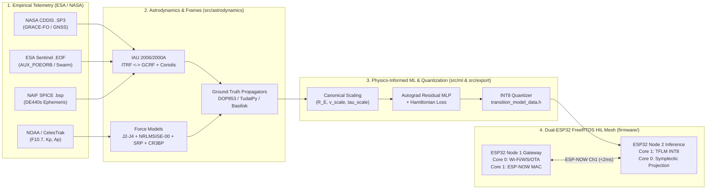

# Nanodynamics-v3 System Architecture & TRL 1–9 Progression

## 1. End-to-End Data & Computation Pipeline

## 2. NASA / ESA TRL 1–9 Modularity Matrix
- **TRL 1–3**: Analytical force models (`src/astrodynamics/force_models.py`), IAU frame transformations (`src/astrodynamics/frames.py`), and Hamiltonian manifold projection.
- **TRL 4–5**: Breadboard validation against empirical ESA Copernicus `.EOF` and NASA `.SP3` flight arcs (`src/ingestion/`).
- **TRL 6**: Hardware-in-the-Loop (HIL) execution on Dual-ESP32 microcontrollers over deterministic 42-byte `OrbitStatePacket` frames.
- **TRL 7–9**: Pluggable avionics bus interface (`CCSDS 133.0-B-2 Space Packet`, UART/RS-422, SPI, CAN) with static arena allocation (`32 KB`, zero heap allocation) and automated FDIR fallback to symplectic Verlet integration if $|\Delta \mathcal{H} / \mathcal{H}_0| > 10^{-5}$.
